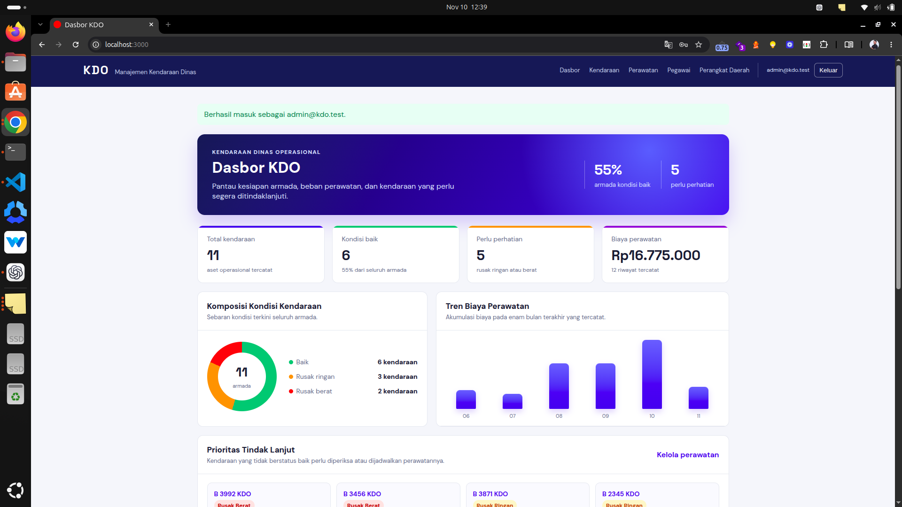

# KDO — Kendaraan Dinas Operasional

KDO adalah aplikasi full-stack Ruby on Rails untuk mendata kendaraan dinas operasional, perangkat daerah pemilik aset, pegawai penanggung jawab, dan riwayat perawatannya. Aplikasi membantu operator mengetahui kondisi armada, penanggung jawab, serta biaya perawatan secara terpusat.

## Fitur utama

- Autentikasi sesi untuk seluruh halaman web, termasuk pembatasan percobaan masuk dasar.
- CRUD lengkap untuk **Perangkat Daerah**, **Pegawai**, **Kendaraan Dinas**, dan **Riwayat Perawatan**.
- Halaman daftar, form, detail, ubah, dan hapus pada tiap entitas.
- Filter pencarian dan pagination pada seluruh daftar web maupun collection REST API.
- Validasi NIP 18 digit, nomor polisi unik, status kendaraan, dan kesesuaian perangkat daerah antara kendaraan dengan penanggung jawabnya.
- Dasbor responsif dengan ringkasan armada, komposisi kondisi, tren biaya enam bulan, kendaraan prioritas, distribusi armada per perangkat daerah, dan riwayat perawatan terbaru.
- Fitur bisnis tambahan: pencatatan perawatan, biaya setiap perawatan, total biaya per kendaraan, dan total biaya pada dasbor.
- REST API versi 1 dengan error handling JSON dan perlindungan `X-API-Key` ketika aplikasi berjalan di production.

## Teknologi

| Komponen | Pilihan |
| --- | --- |
| Bahasa | Ruby 3.2.0 |
| Framework | Rails 8.1 |
| Database | SQLite 3 |
| Antarmuka | Rails server-rendered, CSS responsif |
| API | REST JSON di `/api/v1` |

## Menjalankan aplikasi secara lokal

Prasyarat: Ruby `3.2.0`, Bundler, dan SQLite 3.

```bash
bundle install
bin/rails db:prepare
bin/rails db:seed
bin/rails server
```

Buka `http://localhost:3000`, lalu masuk melalui `http://localhost:3000/sesi/new`.

### Akun demonstrasi

| Email | Kata sandi |
| --- | --- |
| `admin@kdo.test` | `KDO-Demo-2026!` |

Akun tersebut dibuat oleh seed dan hanya berlaku untuk demonstrasi lokal. Jangan gunakan kredensial ini di deployment. Buat akun baru dan simpan rahasia production di secret manager atau environment deployment, bukan di Git, dokumentasi, atau prompt AI.

## Cara menggunakan aplikasi

1. Masuk menggunakan akun demonstrasi.
2. Kelola **Perangkat Daerah** sebagai unit pemilik aset.
3. Tambahkan **Pegawai** dengan NIP 18 digit dan perangkat daerahnya.
4. Tambahkan **Kendaraan** dan pilih pegawai penanggung jawab dari perangkat daerah yang sama.
5. Catat pekerjaan pada menu **Perawatan** untuk menyimpan tanggal, jenis pekerjaan, uraian, dan biaya.
6. Gunakan dasbor untuk melihat kondisi armada, biaya, kendaraan yang perlu perhatian, serta tren perawatan.

Setiap daftar memiliki aksi **Detail**, **Ubah**, dan **Hapus** yang sejajar. Halaman detail menyediakan tombol kembali ke daftar asal. Detail perangkat daerah juga menampilkan pegawai terkait serta nomor polisi dan nama kendaraan terkait.

## Aturan data penting

- Status kendaraan hanya `baik`, `rusak_ringan`, atau `rusak_berat`.
- Nama perangkat daerah, NIP, dan nomor polisi harus unik.
- Kendaraan harus memiliki perangkat daerah dan penanggung jawab.
- Penanggung jawab kendaraan wajib berasal dari perangkat daerah yang sama.
- Data perangkat daerah, pegawai, atau kendaraan yang masih direferensikan tidak dapat dihapus.
- Biaya perawatan bersifat opsional, tetapi bila diisi harus bernilai nol atau lebih.

## URL aplikasi web

| Halaman | URL |
| --- | --- |
| Dasbor | `/` |
| Masuk/keluar | `/sesi/new`, `POST/DELETE /sesi` |
| Perangkat daerah | `/perangkat-daerah` |
| Pegawai | `/pegawai` |
| Kendaraan | `/kendaraan` |
| Perawatan | `/perawatan` |

Nama URL sengaja memakai bentuk sederhana dan mudah dibaca. Nama model Rails tetap mempertahankan istilah domain Indonesia, sehingga perubahan URL tidak memerlukan perubahan skema maupun kontrak data.

## REST API

Base URL lokal: `http://localhost:3000/api/v1`.

| Resource | Collection | Member |
| --- | --- | --- |
| Perangkat daerah | `GET`, `POST /perangkat-daerah` | `GET`, `PATCH`, `DELETE /perangkat-daerah/:id` |
| Pegawai | `GET`, `POST /pegawai` | `GET`, `PATCH`, `DELETE /pegawai/:id` |
| Kendaraan | `GET`, `POST /kendaraan` | `GET`, `PATCH`, `DELETE /kendaraan/:id` |
| Perawatan | `GET`, `POST /perawatan` | `GET`, `PATCH`, `DELETE /perawatan/:id` |

Endpoint collection mendukung `page`, `per_page`, dan filter yang relevan. Di development/test API dapat diuji langsung; di production semua endpoint API wajib menyertakan header `X-API-Key` yang cocok dengan `KDO_API_KEY`.

Lihat [kontrak API dan seluruh perintah curl](docs/API.md) untuk payload, filter, pagination, kode respons, dan contoh pengujian terminal.

## Pengujian

```bash
bin/rails test
bin/rails routes
bin/rails db:migrate:status
```

Test mencakup validasi model dan relasi, autentikasi sesi, halaman detail, serta lifecycle REST API create/read/update/delete dan error validasi. Untuk membuat ulang data development, gunakan berikut **hanya jika data lokal memang boleh dihapus**:

```bash
bin/rails db:reset db:seed
```

Seed bersifat idempoten dan menyediakan 3 perangkat daerah, 9 pegawai, 11 kendaraan, serta 12 riwayat perawatan fiktif lintas enam bulan agar dasbor tidak menampilkan data monoton.

## Dokumentasi proyek

- [Manual setup dan alur demonstrasi](docs/MANUAL_SETUP.md)
- [Kontrak REST API dan curl](docs/API.md)
- [ERD dan aturan integritas](docs/ERD.md)
- [Evaluasi implementasi berdasarkan komponen penilaian](docs/EVALUASI.md)
- [Bukti tampilan aplikasi](docs/SCREENSHOTS.md)
- [Instruksi AI pengembangan](AGENTS.md)
- `db/dumps/kdo_sample.sql`: artefak dump SQLite demonstrasi.

## Bukti tampilan



Tangkapan lengkap, termasuk halaman masuk dan bagian lanjutan dasbor, tersedia pada [docs/SCREENSHOTS.md](docs/SCREENSHOTS.md). Semua data pada gambar adalah data demonstrasi fiktif.

## Penggunaan AI

Proyek ini dapat dikembangkan dengan **Codex menggunakan model GPT Terra** sebagai asisten implementasi. Sebelum meminta perubahan, baca `AGENTS.md` dan dokumentasi terkait.

Contoh prompt yang aman:

> Tambahkan filter status pada daftar kendaraan KDO. Pertahankan endpoint REST yang ada, perbarui test dan dokumentasi API, jalankan seluruh test suite, lalu tampilkan ringkasan perubahan.

Saat menggunakan AI:

1. Berikan tugas dan kriteria penerimaan yang spesifik.
2. Minta AI menjelaskan asumsi yang mengubah aturan bisnis, relasi, atau data.
3. Jalankan test, tinjau perubahan database, dan periksa diff sebelum commit.
4. Jangan memasukkan NIP nyata, kata sandi production, token, API key, atau data pribadi ke prompt.

