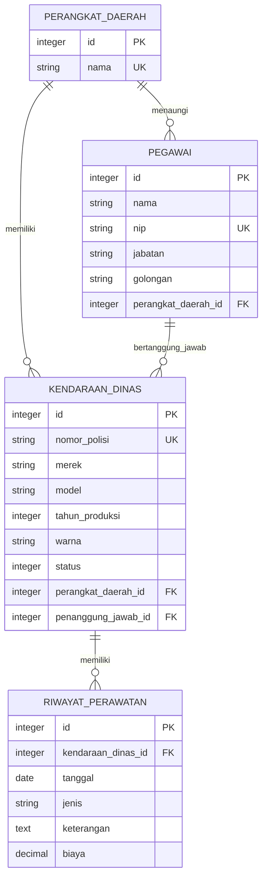

# Entity Relationship Diagram (ERD)

## Aturan integritas

- Nama perangkat daerah dan NIP pegawai unik.
- Nomor polisi kendaraan unik.
- Kendaraan harus mempunyai perangkat daerah dan pegawai penanggung jawab.
- Pegawai penanggung jawab harus berasal dari perangkat daerah yang sama dengan kendaraan.
- Riwayat perawatan harus menunjuk kendaraan yang valid.
- Penghapusan perangkat daerah, pegawai, atau kendaraan yang masih memiliki relasi aktif ditolak oleh aplikasi.
