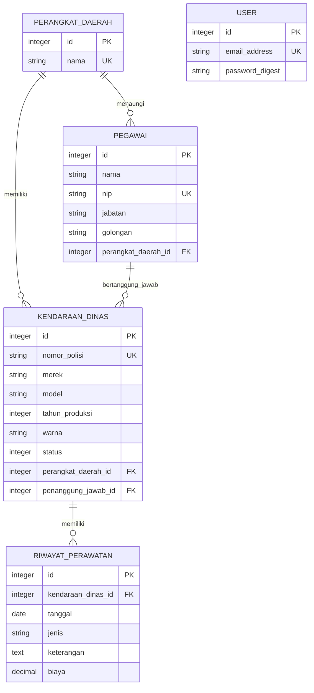

# Entity Relationship Diagram (ERD)

ERD ini memisahkan domain KDO dari entitas teknis autentikasi. `USER` hanya digunakan untuk sesi aplikasi web dan tidak mengubah kepemilikan maupun penanggung jawab aset.

## Penjelasan relasi

| Sumber | Kardinalitas | Tujuan | Makna |
| --- | --- | --- | --- |
| Perangkat Daerah | 1 : banyak | Pegawai | Satu perangkat daerah menaungi banyak pegawai. |
| Perangkat Daerah | 1 : banyak | Kendaraan Dinas | Satu perangkat daerah dapat memiliki banyak kendaraan. |
| Pegawai | 1 : banyak | Kendaraan Dinas | Seorang pegawai dapat bertanggung jawab atas banyak kendaraan. |
| Kendaraan Dinas | 1 : banyak | Riwayat Perawatan | Satu kendaraan memiliki banyak catatan perawatan. |
| User | mandiri | Sesi web | Pengguna masuk ke aplikasi; tidak dihubungkan ke data PNS karena belum ada kebutuhan bisnis untuk itu. |

## Aturan integritas

- Nama perangkat daerah, NIP pegawai, nomor polisi kendaraan, dan email pengguna unik.
- Pegawai wajib memiliki tepat satu perangkat daerah.
- Kendaraan wajib memiliki tepat satu perangkat daerah dan satu pegawai penanggung jawab.
- Pegawai penanggung jawab wajib berasal dari perangkat daerah yang sama dengan kendaraan.
- `status` kendaraan dibatasi ke `baik`, `rusak_ringan`, dan `rusak_berat`.
- Tahun produksi berada pada rentang 1900 sampai satu tahun setelah tahun berjalan.
- Riwayat perawatan wajib menunjuk kendaraan yang valid; `biaya`, jika diisi, tidak boleh negatif.
- Penghapusan perangkat daerah, pegawai, atau kendaraan yang masih memiliki relasi aktif ditolak oleh aplikasi (`restrict_with_error`).

## Indeks dan constraint yang relevan

- Foreign key menjaga referensi ke perangkat daerah, pegawai penanggung jawab, dan kendaraan.
- Indeks unik dipakai untuk `perangkat_daerah.nama`, `pegawai.nip`, `kendaraan_dinas.nomor_polisi`, dan `users.email_address`.
- Validasi model menjadi sumber aturan yang dipakai bersama oleh antarmuka web dan REST API.

