# Bukti Tampilan Aplikasi KDO

Tangkapan berikut dibuat dari lingkungan demonstrasi lokal dengan data seed fiktif. Nilai dan identitas di dalam gambar bukan data operasional atau kredensial production.

## Halaman masuk

Halaman masuk mengarahkan pengguna untuk mengakses aplikasi melalui sesi pengguna.

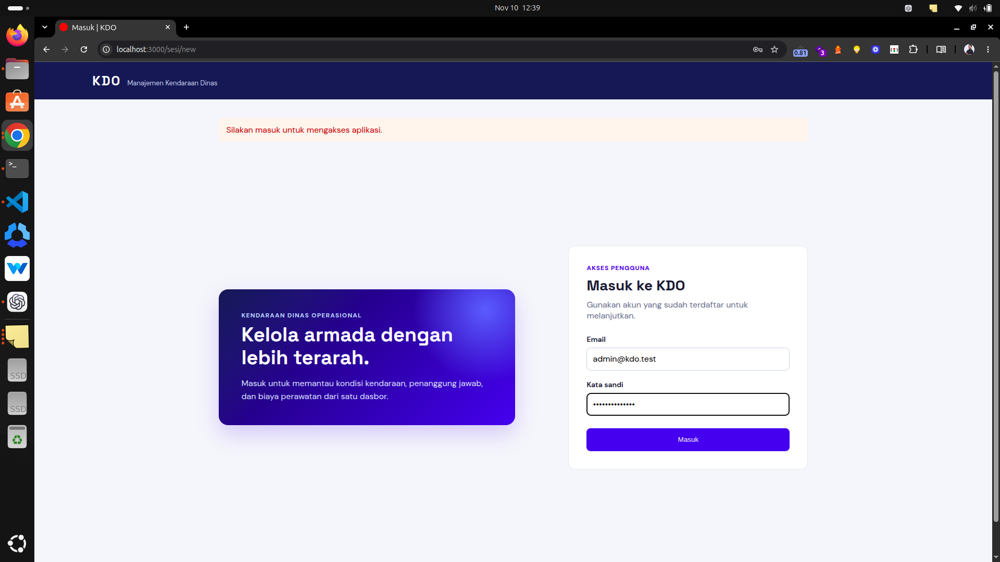

## Dasbor utama

Dasbor menampilkan ringkasan total armada, persentase kondisi baik, kendaraan yang perlu perhatian, total biaya perawatan, komposisi kondisi, dan tren biaya enam bulan.

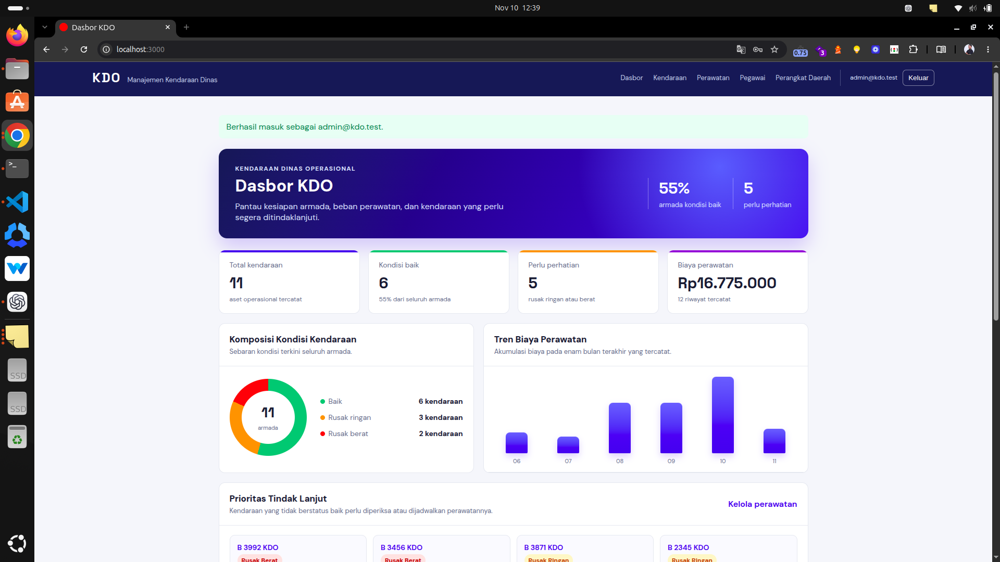

## Dasbor lanjutan

Bagian lanjutan dasbor menunjukkan kendaraan prioritas, distribusi armada per perangkat daerah, riwayat perawatan terbaru, dan kendaraan terbaru.

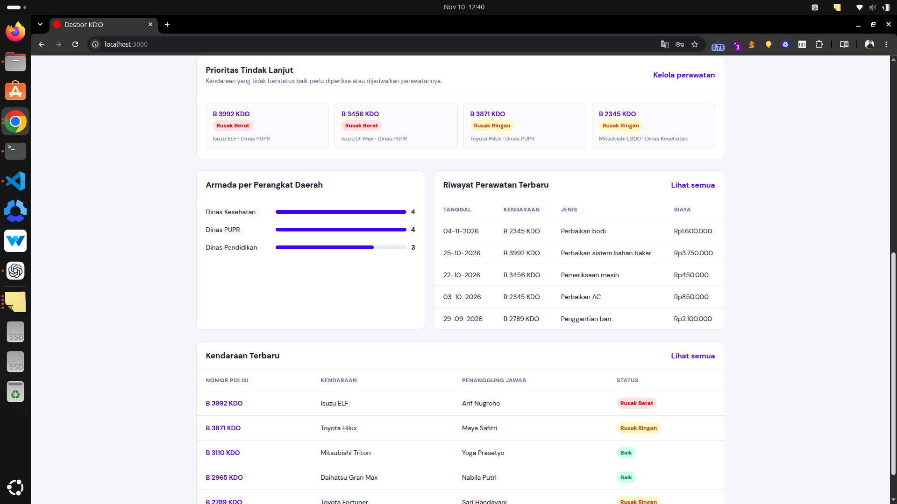

## Daftar, pencarian, filter, dan pagination

Setiap daftar menyediakan pencarian, filter yang relevan, pagination, serta aksi Detail/Ubah/Hapus yang konsisten.

### Kendaraan

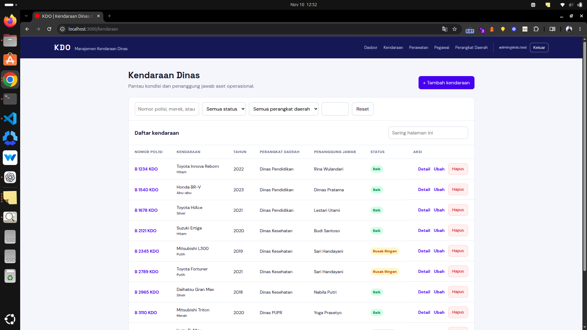

### Pegawai

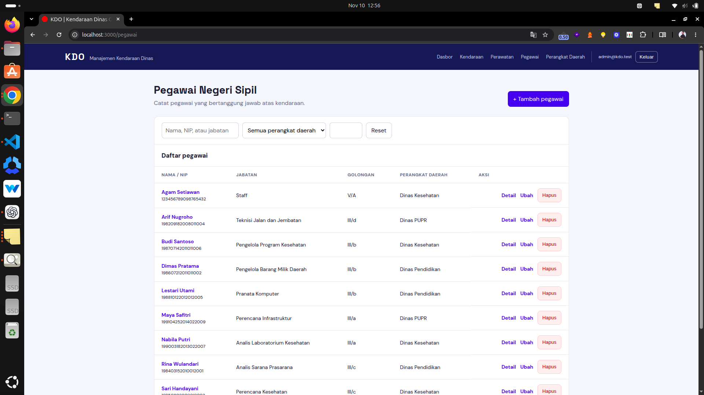

### Perangkat daerah

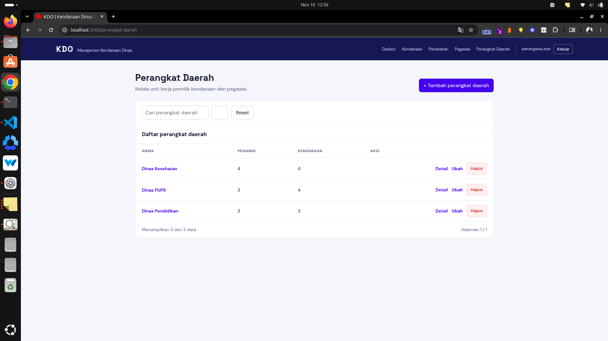

### Riwayat perawatan

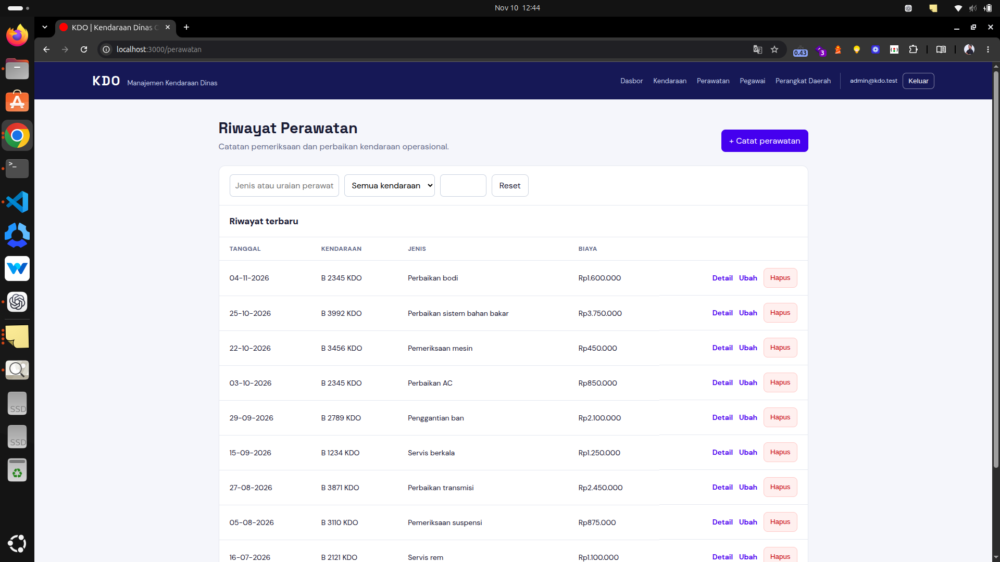

## Formulir responsif

Formulir menampilkan label, bantuan validasi, dan pemilihan relasi yang sesuai dengan aturan domain.

### Form kendaraan

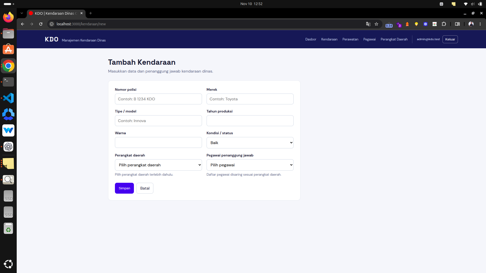

### Form pegawai

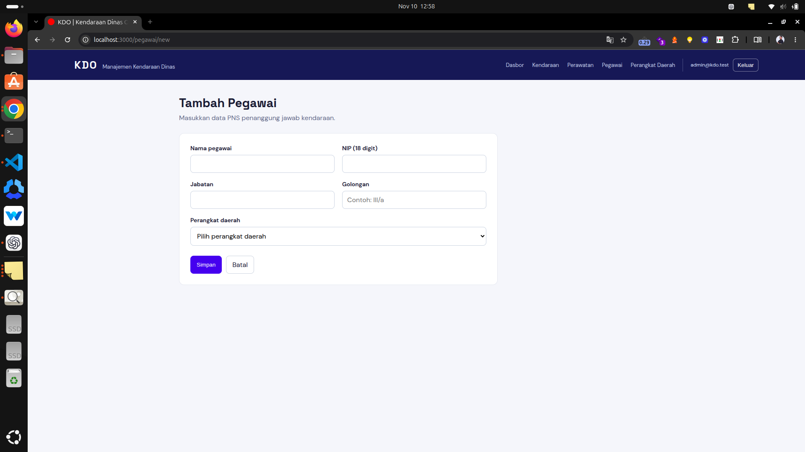

### Form perangkat daerah

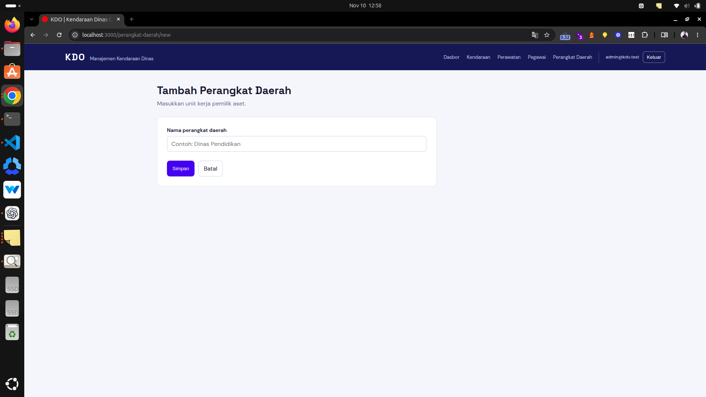

## Halaman detail

Halaman detail menyediakan tombol kembali ke daftar entitas serta tombol ubah. Detail perangkat daerah memperlihatkan relasi pegawai dan kendaraan.

### Detail kendaraan

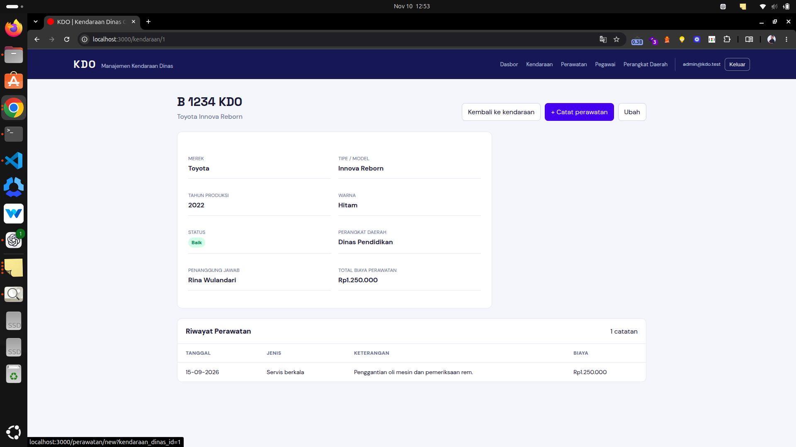

### Detail pegawai

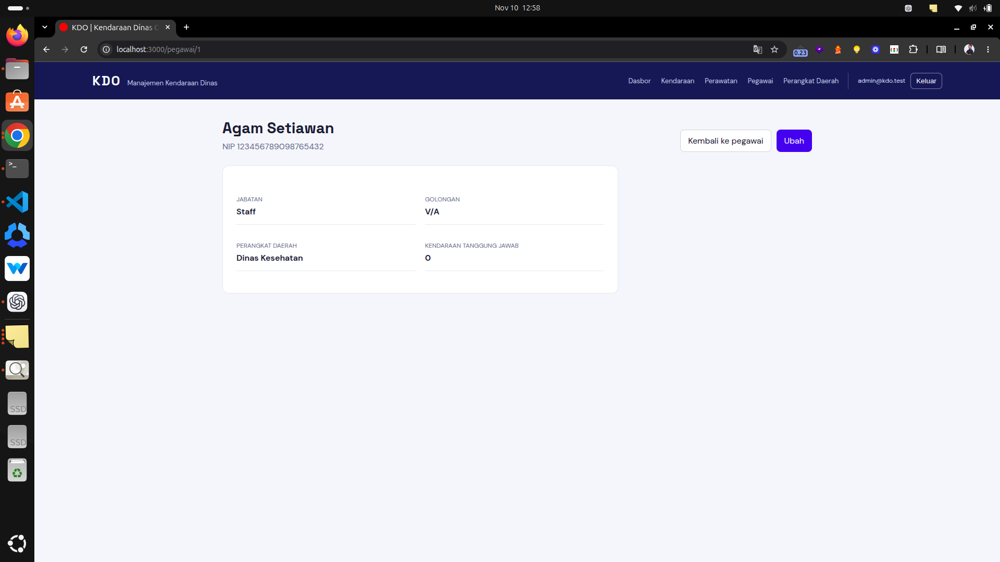

### Detail perangkat daerah

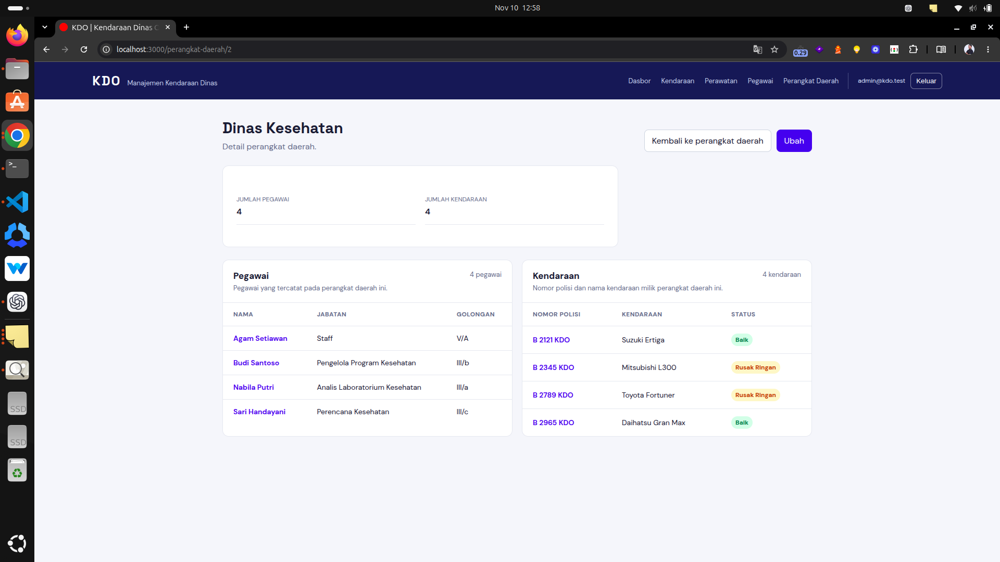

## Cakupan tampilan lain

Selain tampilan di atas, aplikasi menyediakan daftar, filter, pagination, form, detail, ubah, dan hapus pada Perangkat Daerah, Pegawai, Kendaraan, serta Perawatan. Detail perangkat daerah menampilkan nama pegawai dan nomor polisi beserta nama kendaraan yang terkait.
